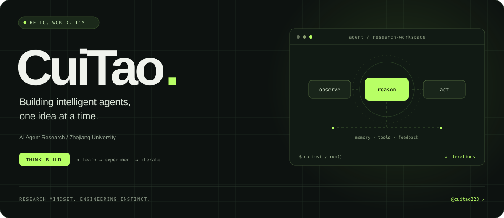
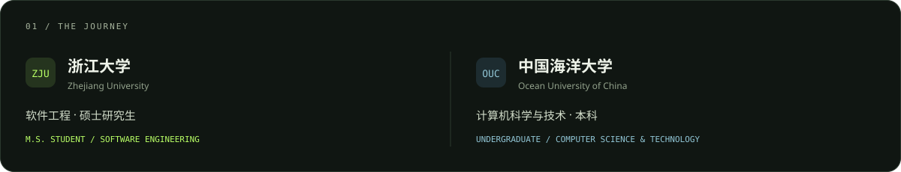
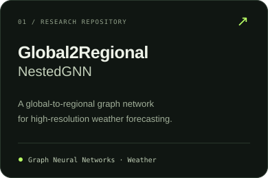
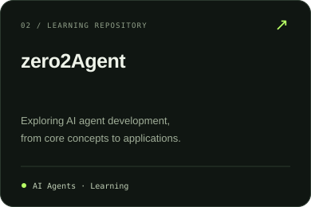
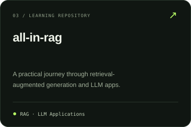

<!-- Profile README for cuitao223. Visual assets are local SVGs; no third-party stats services. -->
<p align="center">
  
</p>

<p align="center">
  <a href="https://cuitao223.github.io"><b>Academic Website ↗</b></a>
  &nbsp;&nbsp;·&nbsp;&nbsp;
  <a href="https://github.com/cuitao223?tab=repositories"><b>Repositories ↗</b></a>
</p>

<br />

<picture>
  
</picture>

<br />
<br />

### A little about me

我是 **CuiTao**，浙江大学软件工程硕士研究生，本科就读于中国海洋大学计算机科学与技术专业。

My research interests center on **AI agents**. I enjoy turning ideas into working systems and learning through experiments.

```python
class CuiTao:
    research = "AI Agents"
    graduate = "Software Engineering @ Zhejiang University"
    undergraduate = "Computer Science and Technology @ OUC"
    mindset = ("stay curious", "build things", "keep iterating")
```

### Research & exploration

研究项目与学习仓库 / Research and learning repositories.

<p>
  <a href="https://github.com/cuitao223/Global2Regional-NestedGNN"></a>
  <a href="https://github.com/cuitao223/zero2Agent"></a>
  <a href="https://github.com/cuitao223/all-in-rag"></a>
</p>

### Let's connect

欢迎交流 AI Agent、研究想法与有趣的工程实践。

**[Visit my academic website →](https://cuitao223.github.io)** &nbsp; · &nbsp; **[Explore my repositories →](https://github.com/cuitao223?tab=repositories)**

---

<p align="center"><sub>Curiosity is the starting point. Building is how I explore.</sub></p>
